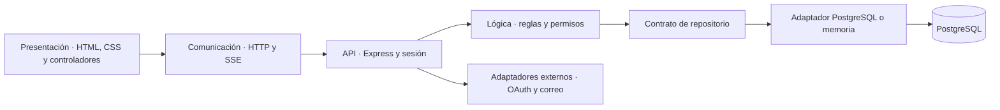
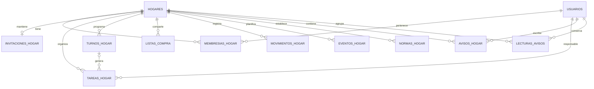
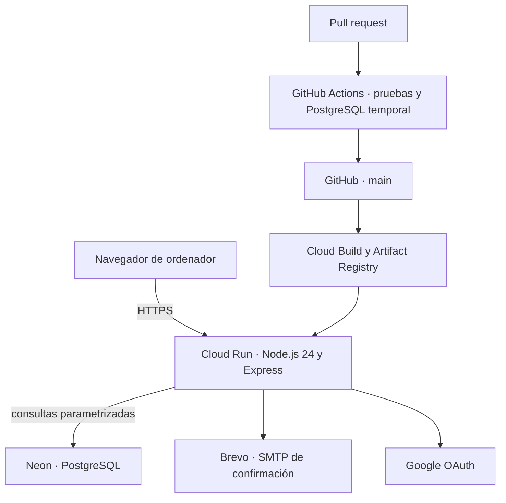

# Arquitectura de HogarDu

He separado la aplicación por responsabilidades para poder modificar una pantalla sin trasladar reglas de negocio al navegador ni introducir SQL en los servicios. El cliente y el servidor comparten repositorio, pero cumplen funciones distintas.

## Capas y dependencias

Las flechas representan el recorrido de una operación. La lógica recibe los repositorios por parámetro: no importa el adaptador PostgreSQL. El punto de entrada selecciona las implementaciones y ensambla las dependencias.

| Responsabilidad | Ubicación | Ejemplos |
| --- | --- | --- |
| Pantallas y estilos | [cliente](../cliente/) | `index.html`, `piso.html`, `estilos.css` y `tema-hogardu.css`. |
| Interacción y representación | [presentación](../cliente/presentacion/) | Acceso, cuenta, tareas, compra, gastos, calendario y avisos. |
| Comunicación | [rest.js](../cliente/comunicacion/rest.js) | Peticiones HTTP, errores de transporte y apertura del canal SSE. No modifica el DOM. |
| Entrada HTTP y ensamblado | [api.js](../servidor/api.js) y [rutas del piso](../servidor/api/api-hogares.js) | Sesiones, peticiones, respuestas y conexión de servicios con repositorios. |
| Lógica de negocio | [lógica](../servidor/logica/) | Usuarios, hogares, dinero, turnos, identidad Google y confirmación. |
| Persistencia | [datos](../servidor/datos/) | SQL parametrizado, transacciones, repositorios, conexión y preparación del esquema. |
| Servicios externos | [infraestructura](../servidor/infraestructura/) | OAuth Google, SMTP y actividad. |
| Errores compartidos | [errores.js](../servidor/compartido/errores.js) | Errores reconocibles entre capas sin importar un servicio desde datos. |

`servidor/api.js` es también la raíz de composición: crea las dependencias, configura el servidor y selecciona PostgreSQL o memoria. Esta selección no se realiza dentro de los servicios de negocio. Los comandos de administración y migración están en [scripts](../scripts/).

En gastos, el servicio valida importes, reparte céntimos y calcula deudas; [datos-finanzas.js](../servidor/datos/datos-finanzas.js) guarda los movimientos. En turnos, [turnos.js](../servidor/logica/turnos.js) calcula fechas, rotación y planes de actualización. El repositorio aplica esos planes dentro de su transacción, para no separar la lectura de la escritura que debe ser atómica.

La revisión del 24 de noviembre agrupó físicamente las capas y eliminó las comunicaciones directas desde presentación. [Cuatro pruebas de arquitectura](../pruebas/arquitectura.test.js) comprueban estas fronteras y las referencias a archivos.

## Almacenamiento real

La aplicación utiliza PostgreSQL en Neon. Las pruebas de lógica usan repositorios en memoria; las de integración usan tablas temporales de PostgreSQL y deshacen sus cambios.

Es un resumen de las relaciones implementadas, no una propuesta de tablas nuevas. La definición está en [esquema.sql](../servidor/datos/esquema.sql) y [migracion-hogares.sql](../servidor/datos/migracion-hogares.sql).

- `usuarios` conserva identidad, nombre, estado, rol global, hash de contraseña, identidad Google y foto personal.
- `membresias_hogar` relaciona cuenta y piso, con un rol propio del hogar.
- Los productos se guardan como JSONB dentro de `listas_compra`. Los gastos y devoluciones se guardan como JSONB en `movimientos_hogar`.
- Las fotos se almacenan como datos de imagen codificados. Los comentarios de fotos forman parte del JSONB de la tarea.
- Los puntos y las deudas se calculan a partir de tareas y movimientos. No hay tablas de saldos manuales ni un cierre mensual inmutable del ranking.
- Las sesiones de Express permanecen en memoria del proceso; no están en una tabla de PostgreSQL.

## Despliegue e integraciones

El mismo servidor entrega los archivos del cliente y la API. La publicación principal es [Cloud Run](https://procesos-martatosca-569228981488.europe-west1.run.app/), en `europe-west1`, con el servicio `procesos-martatosca`. El proceso de construcción y despliegue está configurado en Google Cloud; no depende de que exista un servidor local encendido.

La confirmación de cuentas usa SMTP. El acceso con Google valida el flujo OAuth y puede vincularse a una cuenta local existente. Las pruebas simuladas comprueban el contrato, pero no prueban por sí solas la recepción de un correo ni un consentimiento real de Google.

## Avisos y límites operativos

El chat combina HTTP para consultar y escribir con SSE para recibir señales de cambio. El contenido del mensaje se recupera con una petición autorizada; no se incluye en la señal SSE. El adaptador de datos usa `LISTEN/NOTIFY` para propagar señales y el cliente vuelve a consultar al reconectar.

El despliegue se limita actualmente a una instancia. Al reiniciar el proceso se pierden sus sesiones y puede ser necesario entrar de nuevo. La existencia del canal entre procesos no acredita que el conjunto de la aplicación esté preparado para escalar a varias instancias. La revisión publicada utilizó dos sesiones, no una prueba de carga.

Véanse las [decisiones](decisiones.md), los [procesos de comprobación](procesos.md) y las [instrucciones de ejecución](../README.md).
