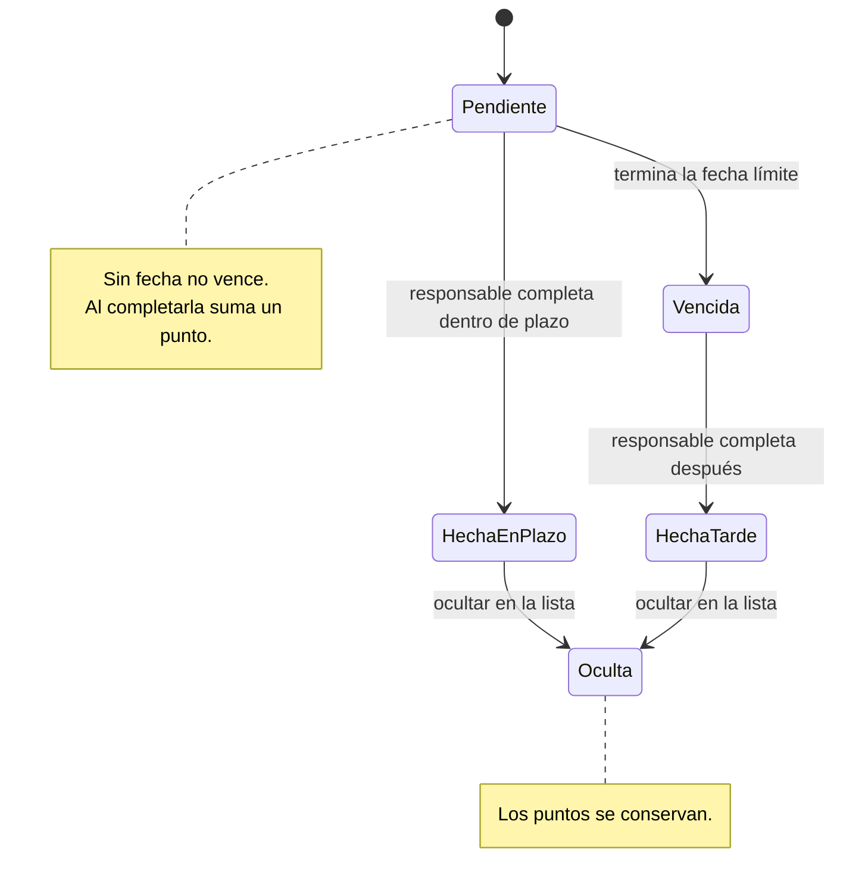
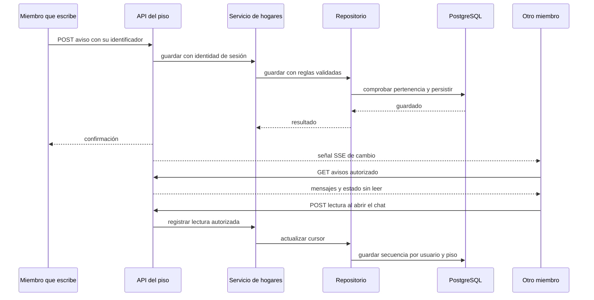

# Procesos de uso y desarrollo

## 1. Crear la cuenta y entrar

1. La persona introduce nombre, correo y contraseña. El servidor valida los datos y el dominio permitido, comprueba duplicados y guarda un hash bcrypt.
2. La cuenta local empieza pendiente. El enlace recibido por correo permite confirmarla; un fallo de envío no activa la cuenta y existe una opción de reenvío.
3. Una cuenta activa inicia sesión. El navegador consulta la sesión al recargar y el servidor comprueba que la cuenta sigue activa.
4. Si Google está configurado, puede utilizarse ese proveedor. Una cuenta local existente no se vincula únicamente por coincidir el correo: el flujo requiere vinculación explícita desde una sesión identificada.
5. Desde Mi cuenta se pueden editar nombre y foto personal y consultar el correo, que no se modifica desde ese formulario.

La explicación técnica está en [decisiones](decisiones.md#d11--sesiones-en-memoria-y-una-instancia) y las instrucciones de configuración, en el [README](../README.md).

## 2. Crear o compartir un piso

1. Después del acceso se puede crear un piso, utilizar una invitación o seleccionar uno de los pisos propios.
2. Al crear, se indica el nombre, la moneda y una foto opcional. La persona creadora pasa a ser administradora de ese hogar.
3. El administrador comparte el código o enlace de invitación. Quien lo usa obtiene una membresía; repetir la misma incorporación no crea otra.
4. Una vez dentro, se navega por Inicio, Tareas, Gastos, Compra, Calendario, Chat de Avisos, Normas y Mi cuenta.
5. El administrador puede editar nombre y foto del piso, renovar la invitación y gestionar las normas. Los demás miembros pueden consultar esas normas.
6. Para abandonar el piso tiene que seguir existiendo un administrador. El sistema rechaza una salida que lo deje sin administración.

## 3. Organizar y completar tareas

En Tareas se distingue entre **Añadir**, **Ver Tareas** y **Lotería de tareas**. Al consultar se puede filtrar por las tareas propias o por las de todo el piso.

- El alta individual pide título, fecha y responsable. También permite una repetición semanal o mensual con participantes ordenados.
- En la lotería se añaden tareas a una lista, se eligen participantes y, si se necesita, una fecha común. El resultado aparece agrupado por persona en una ventana.
- Una tarea pendiente y sin vencer puede editarse desde su menú. En una tarea puntual la edición admite quitar la fecha; las repeticiones necesitan una fecha de inicio.
- Solo el responsable marca su tarea como hecha. En ese momento puede adjuntar una foto opcional. Cancelar la ventana no completa la tarea.
- Si existe foto, se pueden abrir y publicar comentarios sobre ella. Sin foto no se ofrece ese recorrido.
- Las tareas hechas aparecen diferenciadas. Su menú en la interfaz permite ocultarlas; no ofrece el formulario de edición de pendientes. Ocultar no elimina sus puntos.

Los estados de plazo se calculan a partir de fechas; no hay un proceso diario que reste puntos repetidamente.



El ranking agrupa la puntuación del mes. Los empates comparten puesto sin saltos y el podio muestra hasta tres personas. La ventana «Gestión de las puntuaciones» explica estas reglas.

## 4. Compartir compra, gastos y calendario

**Compra:** crear una lista, añadir productos con cantidad opcional, marcarlos o desmarcarlos y eliminarlos cuando corresponda. La lista puede renombrarse o borrarse. Es una lista compartida; no genera un gasto automáticamente.

**Gastos:** registrar concepto, importe, fecha, pagador y participantes. El reparto igual distribuye todos los céntimos; el personalizado debe sumar el total. Los miembros pueden editar o eliminar movimientos de su piso. Cuentas pendientes muestra las deudas compensadas y permite consultar todas o solo aquellas en las que la persona es deudora. Una devolución registra un pago ya realizado fuera de la app; no lo ejecuta.

**Calendario:** consultar el mes, avanzar o retroceder y crear un evento con fecha, título, hora opcional y descripción. Todos los miembros pueden consultarlo; el autor puede editarlo o eliminarlo. Inicio muestra los próximos eventos.

## 5. Avisos y punto de lectura

1. Un miembro escribe un aviso. La API comprueba sesión y pertenencia y guarda el mensaje.
2. El canal SSE comunica un cambio a los clientes conectados. Estos consultan los datos autorizados del chat.
3. Para otros miembros, la secuencia del mensaje determina si sigue sin leer. Un mensaje propio no activa el punto verde para su autor.
4. Al abrir el chat visible se registra la lectura hasta la última secuencia cargada. Los mensajes que lleguen después siguen pendientes de lectura.
5. Cada persona puede editar y eliminar sus mensajes. La foto y el nombre mostrados se obtienen del perfil actual del autor.



El diagrama resume el recorrido; la señal puede recibirse cerca de la respuesta de escritura y no se depende de un orden de llegada entre ambos navegadores. El estado leído se conserva en PostgreSQL, independientemente de que las sesiones estén en memoria.

## 6. Desarrollo, pruebas y publicación

1. Definir el comportamiento esperado y relacionarlo con el requisito o hito.
2. Trabajar en una rama `codex/` y respetar las fronteras de capas. Cambiar los enlaces y las pruebas si se mueve un módulo.
3. Ejecutar las pruebas correspondientes. La revisión completa con una base de pruebas disponible se ejecuta así:

   ```powershell
   npm.cmd ci
   node --env-file-if-exists=.env --test
   ```

4. Abrir un pull request, describir qué cambia y cómo se ha comprobado y esperar a que [GitHub Actions](../.github/workflows/ci.yml) termine correctamente.
5. Integrar en `main`. El disparador configurado en Google Cloud construye y publica la revisión en Cloud Run.
6. Comprobar la aplicación pública. Un CI correcto no demuestra por sí solo que el servicio esté desplegado ni que los proveedores externos estén funcionando.

### Reproducir la comprobación publicada

El [comprobador](../scripts/comprobar-despliegue.js) necesita dos cuentas de prueba configuradas en el entorno y un hogar dedicado llamado `Validación Sprint 2`. La primera cuenta debe administrarlo, la segunda ser miembro y debe existir una tarea pendiente propia de la primera.

```powershell
node --env-file-if-exists=.env scripts/comprobar-despliegue.js --url https://procesos-martatosca-569228981488.europe-west1.run.app/ --hogar UUID_DEL_PISO_DE_VALIDACION
```

Las variables son `USUARIO_PRUEBA_EMAIL`, `USUARIO_PRUEBA_CLAVE`, `ADMIN_EMAIL` y `ADMIN_CLAVE`. No se publican sus valores. El nombre de la segunda variable de cuenta no significa que deba administrar ese hogar.

Antes de ejecutarlo se cierra el chat en las ventanas de ambas cuentas, para que otra ventana no marque los mensajes como leídos durante la prueba. El script crea un aviso temporal, prueba cambios de identidad y del piso y restaura los datos originales al terminar. También modifica el cursor de lectura de la cuenta de validación: por eso no se utiliza con cuentas personales ni con el piso habitual.

La ejecución del 24 de noviembre superó 18 comprobaciones. La señal y el guardado del aviso se observaron en 171 ms en esa ejecución; es una medida puntual, no un compromiso de latencia.

## 7. Criterio de cierre

Considero un cambio terminado cuando su comportamiento está implementado, las pruebas correspondientes pasan, las dependencias y la documentación son coherentes y la revisión se ha integrado. Si afecta a la publicación, compruebo además Cloud Run. Las fechas y horas de los sprints se registran como datos de seguimiento, sin deducirlas de estimaciones ni del tiempo entre commits.
